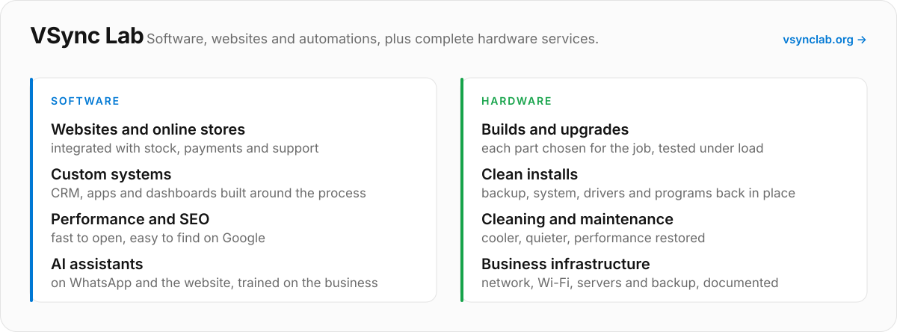
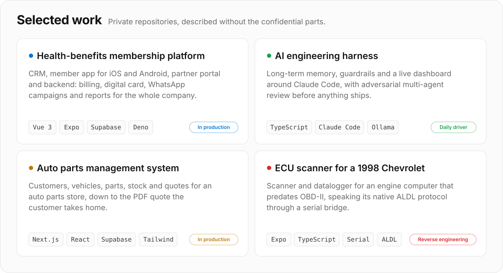
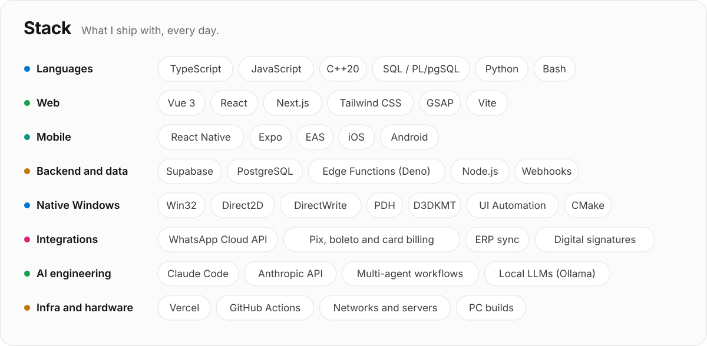

<picture>
  <source media="(prefers-color-scheme: dark)" srcset="assets/header-dark.svg?v=6645-38-207">
  
</picture>

  
  
  

 

I'm Vitor, a software engineer from Guarapuava, Brazil, and the founder of **VSync Lab**.

I build complete products end to end: the database and the rules that protect it, the APIs, the dashboards a team works in all day, the mobile app their customers carry, and the native tools that sit quietly in the Windows taskbar. I care about numbers you can trust, interfaces that explain themselves, and systems that keep working when real life gets messy: lost webhooks, flaky networks, users doing the unexpected.

My workflow is AI-native. Every change goes through tests, an adversarial multi-agent review and a before-and-after measurement before it reaches production.

 

### 🆕 sys-bar, my newest open-source project

CPU, memory, GPU, disks, network, temperatures and fans **inside the Windows taskbar**, next to the clock, with the same numbers as Task Manager. Hover for a detailed card with one-minute graphs; click for Task Manager.

- **Native and tiny.** One C++20 executable on Win32 and Direct2D, no runtime: about 1% of one CPU core and under 20 MB of RAM.
- **Part of the taskbar, not a floating overlay.** Every monitor, Windows 10 and 11, vertical taskbars, per-monitor DPI, 14 languages.
- **Built for the real world.** Survives Explorer restarts, driver resets, sleep, docking and drives coming and going, and updates itself with verified releases.

  
  
  
  

 

<a href="https://vsynclab.org">
  <picture>
    <source media="(prefers-color-scheme: dark)" srcset="assets/vsync-dark.svg">
    
  </picture>
</a>

  

<picture>
  <source media="(prefers-color-scheme: dark)" srcset="assets/work-dark.svg">
  
</picture>

  

<picture>
  <source media="(prefers-color-scheme: dark)" srcset="assets/stack-dark.svg">
  
</picture>

  

  The numbers at the top come from the GitHub API and refresh every day.

